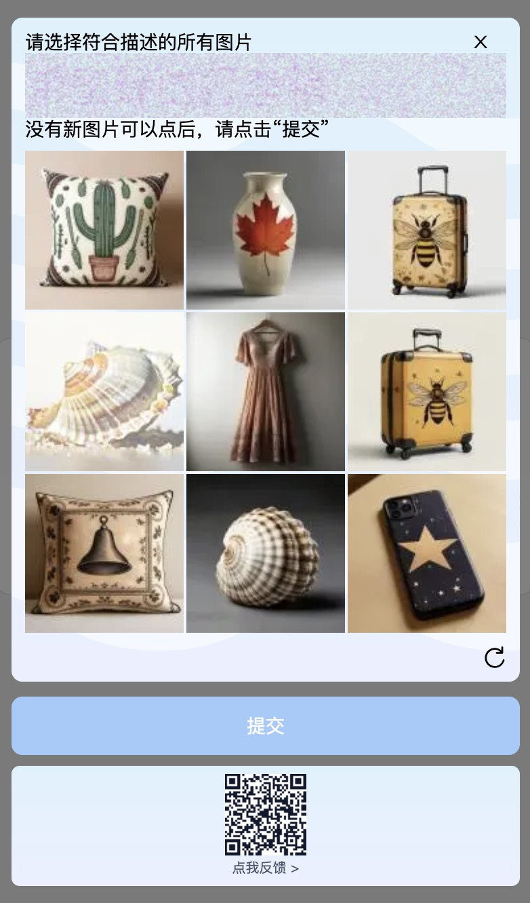

# Qoder 注册链路逆向 — 公开研究笔记

> **状态**：阶段性收尾（2026-10-20）  
> **性质**：纯研究 / 协议分析。目的为公开事实、供社区共同推进。  
> **声明**：本文只记录**协议与机制观察结果**，不提供绕过任何验证的成品工具。研究过程中未修改任何系统硬件信息，所有实验可回滚。

---

## 目录

- [0. 一句话结论](#0-一句话结论)
- [1. 研究对象与边界](#1-研究对象与边界)
- [2. 注册流程全貌（实测）](#2-注册流程全貌实测)
- [3. 两轮人机验证拆解](#3-两轮人机验证拆解)
- [4. ★ 重大发现：设备 ↔ 账号绑定](#4--重大发现设备--账号绑定)
- [5. ★ 观察：网页注册有权益，登录 App 后消失](#5--观察网页注册有权益登录-app-后消失)
- [6. baxia 点选验证的完整结构](#6-baxia-点选验证的完整结构)
- [7. 当前卡点（欢迎接力）](#7-当前卡点欢迎接力)
- [8. 附录：端点与常量清单](#8-附录端点与常量清单)
- [9. 复现环境](#9-复现环境)

---

## 0. 一句话结论

Qoder 的注册链路是 **AliyunCaptcha（可见滑块）+ 阿里 baxia（不可见风控 + 网格点选）** 双层防护；
而设备身份（`machineid = f(IOPlatformSerialNumber)`）贯穿网页与 App，
**服务端按设备维度维护账号关联表**，这很可能是"同机注册不给权益"的技术根因。

---

## 1. 研究对象与边界

| 项 | 值 |
|---|---|
| 目标 | `https://qoder.com/users/sign-up`（国际版 Web 注册） |
| 前置研究 | 同仓库 `../resetfree/`（Qoder 客户端 UMID/machineid 机制逆向） |
| 方法 | CDP 被动侦察 + bundle 静态分析 + mitmproxy 抓包 + 浏览器内只读探测 |
| 未做 | 未修改硬件信息、未绕过付费、未攻击服务端 |

---

## 2. 注册流程全貌（实测）

注册分**三步**（UI 上表现为两步，密码框在邮箱校验后才显示）：

```
【Step 1】姓名 + 邮箱 + 同意条款
   POST /api/v1/verificationCodes?channel=email&scene=register&email=<email>
   header: x-captcha-verify-param: <AliyunCaptcha 通过后的 token>
   → 200 进入密码步

【Step 2】设置密码
   POST /api/v1/auth/check-login-type   （携带 bx-ua 指纹）
   → 触发第一轮 AliyunCaptcha 滑块

【Step 3】邮箱验证码
   POST /api/v1/users                   ← 真正的注册接口
   body: {
     "type": "email_pwd",
     "email": "...",
     "password": "...",
     "code": "<6位邮箱验证码>",
     "name": "First Last",
     "invitation_code": "",
     "bx-ua": "234!..."                 ← baxia 设备指纹（SDK 自动注入）
   }
   → 若风控命中：返回 RGV587 → 弹 baxia 点选
   → 通过后重新提交 → 200 建号成功
```

> **注册接口是 `POST /api/v1/users`，不是 `/users/sign-up`**（后者只是前端路由）。

---

## 3. 两轮人机验证拆解

| 轮次 | 类型 | 形态 | 判定依据 |
|---|---|---|---|
| 第一轮 | **AliyunCaptcha 2.0** | 可见滑块（embed 模式，300×200 背景 + 52×200 拼图块） | `x-captcha-verify-param` 请求头 |
| 第二轮 | **阿里 baxia** | 不可见风控评分 +（命中后）3×3 网格点选 | `bx-ua` 指纹 + 行为轨迹；命中返回 `RGV587_ERROR` |

### 第一轮 scene ID（页面明文注入）

```js
window.captchaScene = {
  "create_me_verification_codes": "udwgwv7k2",
  "create_sessions":              "17on5mo7v",
  "create_verification_codes":    "1r7eif79x"   // 注册用这个
}
```

### 第二轮触发链（全部实测）

```
POST /api/v1/users
 → {"ret":["FAIL_SYS_USER_VALIDATE","RGV587_ERROR::SM::..."],
    "data":{"url":"/api/v1/users/_____tmd_____/punish?x5secdata=...&x5step=2&action=captchaclick"}}
 → 弹 iframe（375×665），内嵌 punish 页面
```

---

## 4. ★ 重大发现：设备 ↔ 账号绑定

App 登录时会自动打开一个页面（实测抓取）：

```
URL   : https://qoder.com/device/selectAccounts?nonce=<...>
标题  : 客户端身份验证
内容  : 允许登录
        继续使用此账户吗？
        账号: <该设备此前用过的账号>
        [继 续]  [使用其他账号登录]
```

**这证明服务端维护 `device → accounts[]` 关联表**，属于标准 OAuth Device Authorization Grant 的账号选择步骤。

结合前置研究（`../resetfree/`）：

```
machineid = f(IOPlatformSerialNumber)     ← 确定性函数，纯本地可复现
          = 例: MH794R2TF2 → 4d483739-3452-422d-9446-326d4d48372d
```

→ **设备识别粒度 = 硬件序列号派生值**，因此换账号不换设备仍会被识别为同一台机器。

---

## 5. ★ 观察：网页注册有权益，登录 App 后消失

| 场景 | 观察到的权益 |
|---|---|
| 网页注册完成（浏览器未登录 App） | **300 积分 + Pro Plan Trial** |
| 同账号登录 Qoder App（同机） | **权益消失**（变回 `PLAN_TIER_FREE` / 0 积分）|

### 推断（Hypothesis，待社区验证）

```
网页注册 → 服务端按"新账号"发放 300 积分 + Pro Trial（账号级默认权益）
   ↓
App 登录 → 上报 cosy-machineid / cosy-machinetoken / signature
   ↓
服务端按设备查历史 → 判定"同设备已领过" → 撤销/不发放权益
```

### 决定性验证实验（建议接力）

> 在**从未注册过的设备**（另一台 Mac / 干净虚拟机）上登录新账号，
> 若权益保留 → H-App-Revoke 成立；
> 若仍消失 → 撤销维度在账号/IP 而非设备。

---

## 6. baxia 点选验证的完整结构

### 6.1 为什么值得记录

baxia 的题目图片**可以完整读取**——WASM 解密后通过 `putImageData` 直接写入 canvas，
**无需逆向 WASM**。这大幅降低了研究成本。

### 6.2 同源 iframe 可直接访问（关键）

```js
// 主页面
const f = document.querySelector('iframe#baxia-dialog-content');   // src 指向 qoder.com 同源
const doc = f.contentWindow.document;                              // ✅ 可访问
```

### 6.3 DOM 结构

| 元素 ID | 尺寸 | 说明 |
|---|---|---|
| `click-question-canvas` | 355×48 | 题目文字（anti-OCR 渲染）|
| `click-grid-0` ~ `click-grid-8` | 120×120 ×9 | 3×3 网格图片 |

### 6.4 canvas 像素完全可读【已证实】

```js
const cv = doc.getElementById('click-grid-0');
const px = cv.getContext('2d').getImageData(0, 0, cv.width, cv.height);
// ✅ 成功，14400 个不透明像素，无 cross-origin 污染
```

**证明**：WASM 解密后的明文图片可通过 `toDataURL()` / `getImageData()` 完整导出。
样例产物见 `artifacts/baxia/`（question.png + grid0..8.png）。

### 6.5 运行时配置（iframe 内 `window._config_`，明文）

```json
{
  "renderTo": "#nocaptcha",
  "NCTOKENSTR": "4ab990e62d53e86bd125435d8809be4b",
  "action": "captchaclick",
  "HOST": "qoder.com",
  "PATH": "/api/v1/users",
  "FORMACTIOIN": "/api/v1/users/_____tmd_____/verify/",
  "BXSTEP": "100",
  "SECDATA": "xg7ec...__bx__qoder.com/api/v1/users",
  "NCAPPKEY": "X82Y__2493f13a1186b7864646f99765a13b57"
}
```

### 6.6 题目接口链

```
GET  .../_____tmd_____/punish?x5secdata=<...>&x5step=2&action=captchaclick
GET  .../_____tmd_____/punishTextFetch        → 题库文案（明文 JSON）
GET  .../_____tmd_____/gridClickGet?token=&appKey=X82Y__<...>&ua=<bx-ua>
                                              → {encryptToken, imageData, ques, images[]}
GET  .../_____tmd_____/gridClickReplace       → 换图/换题
GET  .../_____tmd_____/gridClickVerify        → 提交答案
GET  .../_____tmd_____/report                 → 行为上报
```

### 6.7 实测截图



> 上图为命中 `RGV587` 后弹出的 baxia 点选验证（3×3 网格）。
> 解密后的 9 张网格图见 `artifacts/baxia/grid0.png` ~ `grid8.png`，
> 题目图见 `artifacts/baxia/question.png`。

### 6.8 未解：题目文字是 anti-OCR 图


`questionText` 同样是 WASM 解密后画进 canvas 的**像素**，特征：

- 无纯黑/纯白像素，对比度极低（亮度 p5=194, p95=237）
- 多重混色 + 噪点 + 轻微扭曲
- `tesseract`（chi_sim，多种预处理组合）**全部识别失败**
- `fillText` hook 捕获为空 → 确认并非走 Canvas2D 文字 API

> 结论：题目文字需**多模态视觉模型**识别，无法用传统 OCR 解决。

---

## 7. 当前卡点（欢迎接力）

| # | 卡点 | 状态 | 建议方向 |
|---|---|---|---|
| C1 | 题目文字 anti-OCR | 未解 | 多模态视觉模型直接读 `question.png` |
| C2 | 9 张网格图需识别目标物（如"轮胎"） | 未解 | 同上（视觉模型分类） |
| C3 | baxia 行为评分（`bx-ua` 指纹生成） | 未解 | 逆向 `AWSC/baxia` SDK + `program.wasm` 导出函数 `f/g/h/i/j/l/m/n` |
| C4 | 设备↔账号绑定的 deviceId 具体来源 | 待证 | 抓 App 登录时 `selectAccounts` 的 deviceId 参数 |
| C5 | 权益撤销的触发接口 | 待证 | 对比 App 登录前后 `GET /api/v1/me/userplan` |

### 已经跨过的坑（供参考）

1. **antd Form 无法用 DOM 事件注入** — 必须通过 React fiber 找 Form 实例调 `setFieldsValue`
2. **`/api/v1/users` 才是注册接口**，`/users/sign-up` 只是前端路由
3. **CSRF 用 `Sec-Fetch-Site` 校验**（`window.csrfToken = '_echo_csrf_using_sec_fetch_site_'`），curl 需带该头
4. **无痕上下文会被污染** — 一次失败后必须新建 browserContext，否则表单提交静默失效
5. **baxia iframe 同源可访问**，无需逆向 WASM 即可拿到明文图片
6. **AliyunCaptcha 滑块只认 JS `.click()`** 触发，CDP 鼠标事件无效

---

## 8. 附录：端点与常量清单

### 注册相关端点

```
POST /api/v1/auth/check-login-type
POST /api/v1/verificationCodes?channel=email&scene=register&email=      (hdr: x-captcha-verify-param)
POST /api/v1/users                                                       (body: type/email/password/code/name/bx-ua)
GET  /api/v1/me
GET  /api/v1/me/userplan
GET  /api/v2/me/usages/big_model_credits
GET  /device/selectAccounts?nonce=                                       (App 登录设备账号选择)
```

### baxia 端点

```
GET /api/v1/users/_____tmd_____/punish
GET /api/v1/users/_____tmd_____/punishTextFetch
GET /api/v1/users/_____tmd_____/gridClickGet
GET /api/v1/users/_____tmd_____/gridClickReplace
GET /api/v1/users/_____tmd_____/gridClickVerify
GET /api/v1/users/_____tmd_____/report
```

### 关键常量

```
AliyunCaptcha SceneId (注册) : 1r7eif79x
baxia appKey                : X82Y__2493f13a1186b7864646f99765a13b57
baxia 静态资源               : g.alicdn.com/bsop-static/scratch-captcha/0.0.59/index.js
                             g.alicdn.com/sd/punish/0.0.4/program.wasm
                             g.alicdn.com/secdev/sec-captcha/0.0.20/program.wasm
```

---

## 9. 复现环境

```
macOS + Chrome（--remote-debugging-port=9366，独立 user-data-dir）
Node 18+（原生 WebSocket）
mitmproxy（抓包）
网络：qoder.com 需可直连；邮件服务需代理（视网络环境）
```

### 仓库结构

```
qoder-register/
├── README.md                    ← 本文
├── RECON.md                     ← 被动侦察报告（端点图、页面结构）
├── A1-device-account-binding.md ← 设备↔账号绑定证据（归档）
├── A2-baxia-analysis.md         ← baxia 静态分析
├── NOTES.md                     ← 过程记录与踩坑
├── code/                        ← CDP 驱动与流程脚本
│   ├── cdp.js                   ← CDP 封装（人类节奏、拟人轨迹）
│   ├── incog.js                 ← 无痕上下文管理
│   ├── page-submit.js           ← 填表+提交（含 antd Form 绕过）
│   ├── step2-submit.js          ← 密码步提交
│   ├── capture-success.js       ← 全量网络监听
│   └── ...
├── bundles/                     ← 前端 JS / WASM 存档
└── artifacts/
    ├── baxia/                   ← 题目图 + 9 张网格图（实测样本）
    ├── manual-flow-*.jsonl      ← 完整请求/响应记录
    └── ...
```

---

## 10. 关联研究

同仓库的 `../resetfree/` 完整分析了 Qoder 客户端的设备身份机制：

- `machineid = f(IOPlatformSerialNumber)`（100% 离线复现）
- 三层缓存架构（进程内存 → `cache/id` → `machine_token.json`）
- umid 由 SecurityGuard 生成，日常启动零联网
- 存在隐藏持久层（未定位）

这两条线（Web 注册 / 客户端设备身份）在 `machineid` 处交汇，共同解释"同机多账号"的识别机制。

---

## 参与

欢迎补充：多模态识别方案、baxia `bx-ua` 算法、设备绑定接口细节。
**请遵守：只做协议研究，不发布绕过验证的成品工具。**
